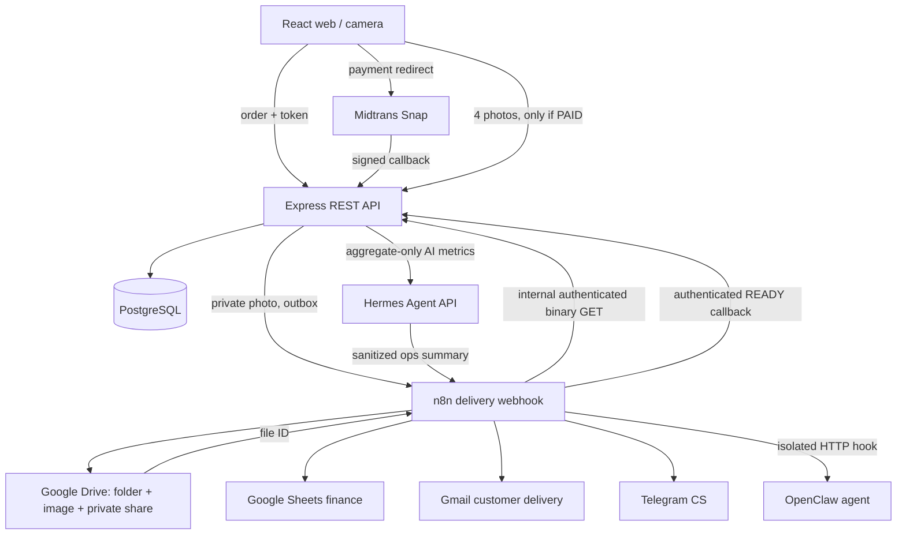

# Arsitektur teknis — Era Snap

## State machine and safety invariants

1. `PENDING` => `PAID` only after Midtrans SHA-512 verified callback or explicitly enabled **local demo**.
2. `PAID` => `PROCESSING` after four valid image uploads. The API privately stores the composite. **No public photo URL**.
3. `PROCESSING` => `READY` only after Google Drive upload + reader permission is added; backend `/internal/orders/:id/ready` requires `x-internal-api-key`.
4. `/api/orders/:id/download` requires bearer token, status `READY`, and a Drive file ID. Preview via `blob:` occurs only on the customer's own device before upload.
5. Each order has a random access token returned only once; database stores SHA-256 digest. HTTPS is required outside localhost.
6. Internal routes need `INTERNAL_API_KEY`, kept off browser and out of repo.
7. n8n inbound webhooks are reachable on the private Compose network; signature header check in Code nodes uses a private environment secret. Never open `/webhook` publicly without upstream auth, network policy, rate limiting, and verified HTTPS.
8. Hermes receives aggregate operational metrics, **not** raw photos, customer email, or phone. OpenClaw gets an AI-written, anonymized operations summary, not payment keys or user photos.

## Operational limits & production additions

- First-stage outbox retries until n8n accepts the webhook. Once n8n acknowledges, a subsequent workflow failure may leave the session in PROCESSING. Set up n8n failure alerts, review orphaned sessions, and implement idempotent Drive upload/reconciliation before public launch.
- n8n nodes must be connected to real OAuth credentials (Drive, Sheets, Gmail) and Telegram Bot API credentials. The JSON exports have **no provider secrets**.
- Build a proper event dashboard, refund and disputes flow, rate limits per order, media retention/deletion policy, backup and restore drills, observability, encryption at rest, and vulnerability scans before handling public payments at scale.
- Deployment needs domain + TLS reverse proxy, updated/pinned images, CS inbox ownership, Gmail quota monitoring, storage caps, payment legal/merchant setup, privacy policy, consent, and terms.
- Photo templates are original visual motifs. Do not include copyrighted idol/anime art, logos, or music without permission.
